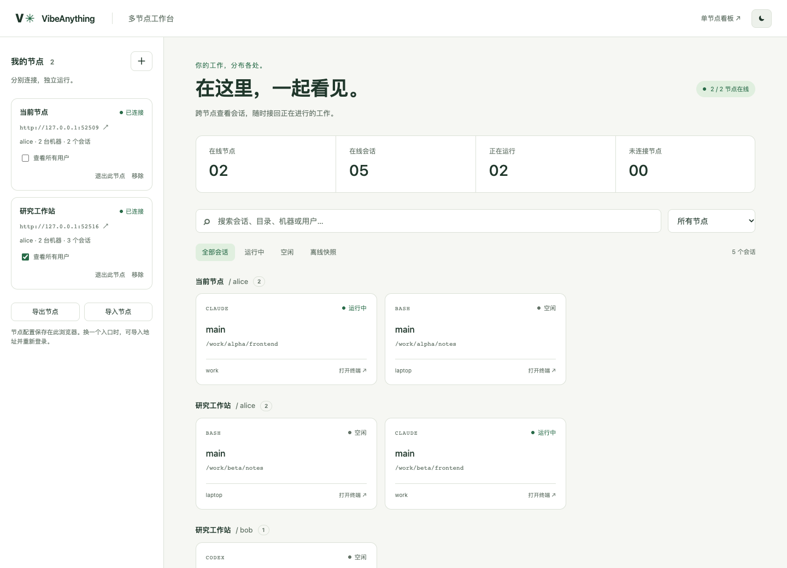
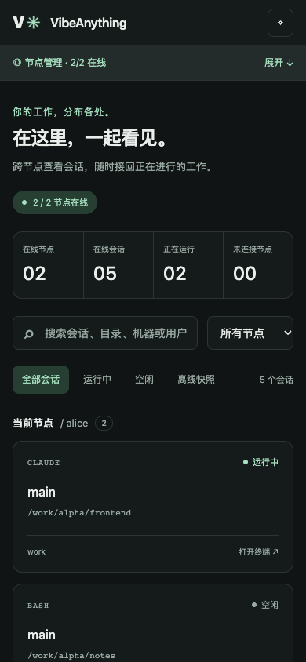
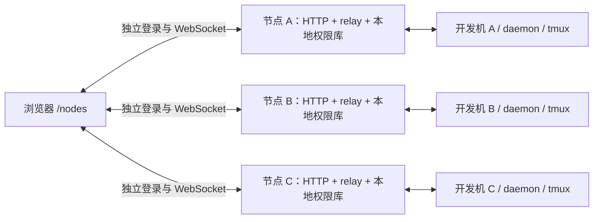

# 多节点看板与去中心化部署设计

VibeAnything 的 `/nodes` 页面把多个独立节点的会话汇总在一个浏览器里。浏览器直接连接每个节点，各节点保管自己的账号、权限和会话数据。

## 已实现

- 节点添加、独立登录、30 天滑动续期、退出和移除。
- 跨节点搜索：会话名、工作目录、机器、用户、工具名称；多个关键词同时匹配。
- 按节点与用户分组；管理员可分别切换各节点的“查看所有用户”。
- 全部、运行中、空闲、离线快照四种筛选。
- 直接打开所属节点的终端，复用已有输入法、复制粘贴、文件上传和终端尺寸协商。
- 每个节点独立重连。掉线后保留本页最后收到的列表，标为“状态未知”，禁用终端入口。
- 导出与导入节点地址。导出的 JSON 只含名称与地址。
- 深浅色主题；手机上的节点管理可折叠，让会话列表处于主要位置。

单节点桌面、手机和登录页都提供“多节点总览”入口。多节点页可以直接访问，不要求先登录承载页面的那台服务器。

## 界面

以下截图使用两个本地测试节点。



<details>
<summary>手机布局</summary>



</details>

## 架构



节点服务与开发机可以运行在同一台机器上。这样 A 的 relay 故障只影响 A，B 与 C 的终端仍可使用。现有中央服务器也可以作为一个节点接入，多台开发机仍由它管理。

页面的静态文件在初次打开时从一个入口下载。终端模块随页面加载，因此入口在之后停机，也不会阻止用户首次打开其他节点的终端。

### 数据归属

| 数据 | 存放位置 | 更新者 |
| --- | --- | --- |
| 节点名称与地址 | 浏览器 localStorage | 当前浏览器用户 |
| 节点登录票据 | 浏览器中各节点自己的条目 | 对应节点登录与续期接口 |
| 账号、会话归属、共享授权 | 节点的 users.db | 该节点的既有 API |
| tmux、PTY、上传文件 | 会话所在开发机 | 该机 daemon |
| 在线状态与离线快照 | 当前页面内存 | 对应节点的 WebSocket |

会话的前端身份是 `[nodeUrl, machineId, sessionId]`。同名机器、同名 tmux 会话在不同节点上可以共存；同名用户在不同节点也分别分组。节点地址经规范化后作为节点标识。

节点之间不复制用户表和终端状态。每份会话状态只有所属节点写入，页面负责汇总，所以当前功能没有跨节点写入冲突。

### 连接与消息

每个已登录节点使用一条 WebSocket。连接握手确认 `whoami` 后标为在线，之后消费 `session_list`、`machine_list`、`active_sessions` 和 `hook_event`。重新连接成功时清掉旧快照，接受新列表；机器从在线列表消失时清掉该机的会话。

终端操作发送到选中会话所属节点的连接，并携带原始 `machineId` 与 `sessionId`。relay 在转发 `pty_data` 时补上机器名，一次序列化后供所有观众复用。桌面和手机终端都同时匹配机器名与会话名。

登录与续期请求有 10 秒超时。普通断网按 1 秒起、最多 30 秒的退避重新连接；仅 401 清除对应节点的登录和会话。活跃页面每 6 小时续期，切回前台沿用现有续期规则。

## 接入与部署

### 1. 更新各节点

所有参与节点都部署这一版服务端与前端。服务端新增 `node-cors.js`，`index.js` 引用它；`relay.js` 补充终端输出的机器信息。前端构建增加 `nodes.html`。

```sh
cd packages/server/frontend
npm run build
```

发布时先让新服务端生效，再替换前端产物。旧前端可以接收补充了机器名的消息；新终端需要新版 relay 提供该字段。

### 2. 配置允许的看板来源

同源访问无需额外配置。若在节点 A 的页面里登录节点 B，在 **B** 的进程环境中设置 A 的浏览器 origin：

```sh
DASHBOARD_ORIGINS=http://node-a:3000,https://dashboard.example.com
```

origin 包含协议、主机与端口，不含 `/nodes` 路径和末尾斜杠。需要从 B 反过来管理 A 时，在 A 上也设置 B 的 origin。systemd 可以在该服务的 override 中加入：

```ini
[Service]
Environment="DASHBOARD_ORIGINS=http://node-a:3000,https://dashboard.example.com"
```

修改后重新加载 systemd 配置并重启对应服务。跨域响应头仅用于登录和续期接口，账号权限继续由节点执行。

HTTPS 看板填写 HTTPS 节点地址。浏览器必须能够访问所有配置的节点地址；沿用现有 Tailscale 内网即可。节点联通不需要改动 Tailscale 出口配置。

### 3. 添加节点

打开任一节点的 `/nodes`，点击“添加节点”，填名称和服务根地址，在该节点卡片里登录。首次使用时自动添加当前入口，并沿用已有的同源登录。

把节点清单转移到另一个浏览器或入口时，导出 JSON，再从新页面导入并逐节点登录。不要把 `users.db`、JWT 密钥或机器 token 当作节点清单转移。

## 从多节点到每机自治

目前已经实现的是多个独立 relay 的浏览器聚合。真正把现网对中央服务器的依赖分散开，需要将服务部署到开发机：

1. 选择一台开发机作为首个自治节点。在该机启动现有 `packages/server`，使用自己的数据库、端口与 JWT 密钥，并创建本节点账号。
2. 把该机 daemon 的 `centralServer` 指向本机节点。当前 daemon 同时连接一个 relay；迁移时该机的浏览器终端会短暂重连，tmux 进程继续在本机运行。
3. 在本节点重建需要的会话归属、用户和共享关系，将该节点加进 `/nodes`。验证会话列表、终端输入输出和文件上传。
4. 保留其他开发机的接入方式，逐台重复。完成后中央服务器可以仅承担静态入口，或者作为普通节点继续存在。

下一步适合增加 `vibeanything node init/start/status`：复用现有 server 与 daemon 管理代码，一次完成本机服务、账号初始化与 daemon 指向。首轮不需要改写 relay 协议；验收以“另一节点不可达时，本机仍能登录、查看会话和操作终端”为准。

## 已知限制

- 当前交付没有迁移现网 daemon，也没有让一份会话同时挂到多个 relay。仍挂在同一 relay 下的开发机共享该 relay 的故障范围。
- 浏览器页面刷新仍需可用的静态入口；没有离线应用缓存。换入口后，浏览器存储按 origin 隔离，需要导入地址并重新登录。
- 离线快照只在当前页面内存中，刷新后不会恢复；离线节点无法操作终端。
- 新总览一次展示一个终端。创建会话、文件夹管理、共享管理、用量统计仍从各节点的原看板进入。
- 同一节点的多个域名会被当成不同节点；节点地址变更时需重新添加。
- 旧的单节点桌面/手机工作区仍有仅按 sessionId 管理打开标签的路径，不同机器的同名会话可能在标签管理时合并。新多节点总览已使用三段身份；这次补齐了两种终端的输出来源匹配，未整体改写旧工作区的标签管理。

## 验证记录

新增测试覆盖节点隔离、断线快照、按机器合并列表、续期换票、401 单节点退出、释放连接、管理员范围、搜索与用户分组，以及跨域预检与错误响应。

自动化检查：前端 560 项、服务端 110 项通过，前端构建与新增模块 ESLint 检查通过。

Chrome 集成验证启动两套独立的真实 HTTP/relay 服务、独立数据库和 JWT 密钥，使用测试开发机消息源；从 A 页面真实登录 B，确认搜索、同名会话、用户分组和终端输入路由。停止 A 后，B 的终端继续收发。桌面、浅色与 390px 手机布局均做了浏览器检查。测试开发机回送终端数据，这项验证不替代真实 tmux/输入法硬件测试。
